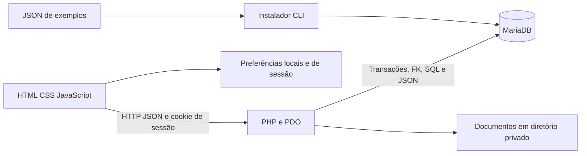

# 02 — Arquitetura atual

Revisado em 26/10/2026. Aplicação multipágina; não é SPA. Frontend sem framework, API PHP/PDO, MariaDB e arquivos privados.

`config/`, `database/`, `scripts/` e `storage/` ficam fora da raiz pública `ong-connect/`. A API valida entradas, CSRF e escopo da ONG. Operações críticas usam transações e bloqueios para capacidade, filas, idempotência e controle de CNPJ.

| Componente | Responsabilidade |
|---|---|
| `api/index.php` e `bootstrap.php` | Roteamento, catálogo, validações e PDO |
| `api/security.php` | Sessão, perfis, vínculos e auditoria |
| `api/participation.php` | Candidaturas e doações |
| `api/public-transfers.php` | Repasses e documentos privados |
| `api/reports.php` | Consultas consolidadas, sem gravar relatórios |
| `api/segments.php` | Segmentos controlados |
| `assets/js/app.js`, `navigation.js`, `account.js` | Base pública, navegação e conta |
| `assets/js/reports-admin.js`, `repasses-publicos.js`, `auditoria.js` | Telas com finalidades separadas |

`loadData()` consulta o catálogo e, na versão atual, também pode carregar registros compartilhados para usuários autenticados. A varredura de desempenho identificou dependências excessivas; as otimizações ainda não foram aplicadas. Não se deve descrever cache de dados privados ou navegação persistente como funcionalidades prontas.
