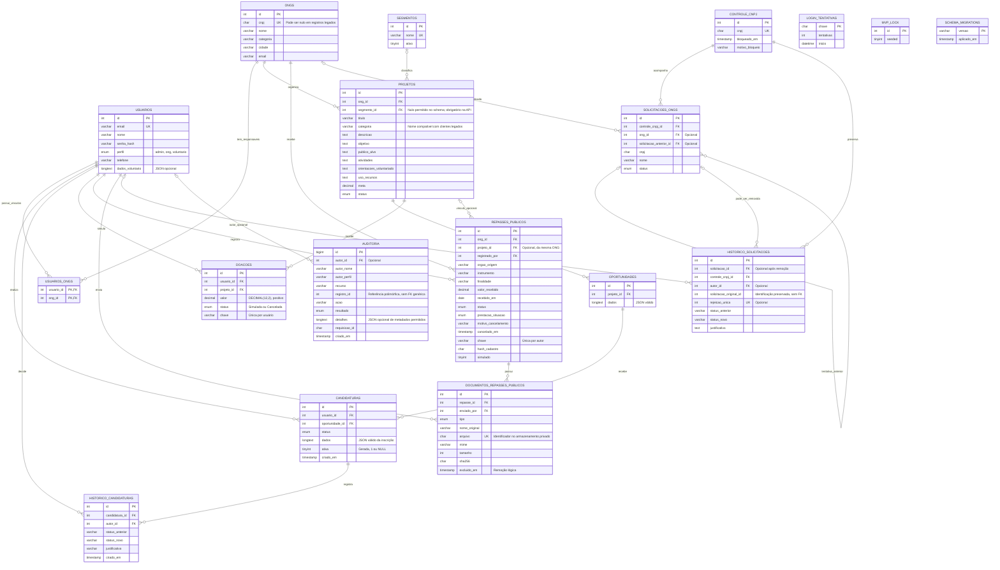

# 09 — Modelagem atual, DER e dicionário de dados

Revisado em **26/10/2026**. A referência física é `database/schema.sql` somado às migrações `001_shared.sql` a `007_segments.sql`, na pasta externa. Não execute apenas o schema inicial para representar o estado final.

## Modelo conceitual e cardinalidades

Uma ONG possui projetos e responsáveis vinculados. Cada projeto seleciona um segmento e oferece oportunidades. Usuários voluntários se candidatam a oportunidades; cada candidatura possui decisões históricas. Doações privadas se relacionam a usuário e projeto. Repasses públicos pertencem a uma ONG e, opcionalmente, a um projeto da mesma ONG; podem ter documentos privados. Solicitações de ONG e seu histórico se vinculam ao controle permanente do CNPJ. A auditoria registra ações e pode manter o nome do autor mesmo após exclusão da conta.

O diagrama representa os principais atributos e todas as tabelas, sem repetir cada campo de apresentação e timestamp. `PK` é chave primária, `FK` é estrangeira e `UK` indica unicidade. As três tabelas técnicas isoladas não têm relacionamentos de negócio. As cardinalidades opcionais representam a nulabilidade física; não eliminam exigências adicionais da API.

## Dicionário e regras verificáveis

| Tabela | Responsabilidade e restrições |
|---|---|
| `ongs` | Identificação e contato institucional; CNPJ único quando preenchido |
| `usuarios` | Conta, hash da senha, perfil e dados do voluntário; e-mail único |
| `usuarios_ongs` | Associação N:N de contas responsáveis e ONGs; PK composta evita vínculo repetido |
| `segmentos` | Vocabulário controlado; nome único, ativação/desativação sem apagar projetos |
| `projetos` | FK para ONG/segmento, descrições e meta; totais antigos `arrecadado`/`voluntarios` são legados, não a origem dos indicadores atuais |
| `oportunidades` | FK para projeto e JSON de título, vagas, modalidade, local, dias, horários e abertura |
| `candidaturas` | FK para usuário/oportunidade; índice único `(usuario_id,oportunidade_id,ativa)` impede duplicidade ativa e permite histórico inativo |
| `historico_candidaturas` | Transições com autor, justificativa e data; não substitui toda a fotografia de cada campo |
| `doacoes` | Valor positivo `DECIMAL(12,2)` e chave única por usuário; simulação idempotente |
| `repasses_publicos` | Recebimento positivo, origem, instrumento, prestação de contas e cancelamento; chave composta `(projeto_id,ong_id)` impede projeto de outra ONG |
| `documentos_repasses_publicos` | Metadados do arquivo, autor, integridade SHA-256 e exclusão lógica; conteúdo não fica no banco |
| `controle_cnpj` | Chave normalizada persistente, bloqueio após três rejeições distintas |
| `solicitacoes_ongs` | Pedido, situação, ligação com controle e eventual ONG publicada |
| `historico_solicitacoes` | Decisões preservadas após exclusão; rejeição contabilizada uma vez por solicitação |
| `auditoria` | Autor, alvo, ação, resultado e correlação; permite ações públicas sem autor autenticado |
| `login_tentativas` | Contador e janela temporal para limitar tentativas |
| `mvp_lock` | Serialização de determinadas gravações e controle da carga inicial |
| `schema_migrations` | Versões aplicadas pelo migrador |

### Integridade no banco e na API

FKs garantem existência dos vínculos. `DECIMAL` mantém representação decimal dos valores armazenados. Índices únicos protegem CNPJ, e-mail e reenvios. Transações e bloqueios impedem exceder a última vaga e preservam a sequência das decisões. A API valida perfis, dias/horários, capacidade, datas e escopo da ONG; essas regras não são garantidas apenas pelo DER.

A categoria textual de `projetos` é mantida por compatibilidade e atualizada junto ao segmento. O ID é a referência controlada. Uma alteração SQL direta que ignore a API pode desalinhar a cópia do nome; não se declara normalização completa de todos os campos. `dados` e `dados_voluntario` também são uma escolha de desnormalização parcial, analisada no trabalho.

### Relacional + JSON efetivamente utilizado

Os documentos são guardados em `LONGTEXT` com `CHECK(JSON_VALID(...))`, e não em `jsonb`. Exemplos: `oportunidades.dados`, `candidaturas.dados`, `usuarios.dados_voluntario` e `auditoria.detalhes`. IDs de negócio permanecem em colunas relacionais. A validação de JSON não obriga um documento a ter um número positivo de vagas nem valida relações; essas verificações estão no PHP.

No modelo tradicional alternativo do experimento, dias ficam em uma tabela associativa por oportunidade. No modelo efetivo, a lista é parte do documento. Consulte [experimento](academico/EXPERIMENTO.md) para a comparação reproduzível; ele não altera o schema do portal.

### Exclusões, documentos e histórico

Solicitações removidas podem deixar seu histórico ligado ao controle permanente de CNPJ, com FK da solicitação nula. Doações/repasses cancelados permanecem registrados; cancelamento não é exclusão. Documentos usam `excluido_em`; os backups precisam abranger banco e armazenamento privado. A auditoria não é um log inviolável de todas as versões e não tem uma FK para cada possível `registro_id`.

## Evolução física

| Migração | Alteração |
|---|---|
| `001_shared` | Contas, vínculos, candidaturas, decisões, doações, auditoria e tentativas de login |
| `002_legacy_schedule` | Compatibilidade da agenda legada |
| `003_cnpj_audit` | Controle permanente de CNPJ, preservação de histórico e auditoria ampliada |
| `004_project_details` | Objetivo, público, atividades e orientações de projetos |
| `005_public_transfers` | Repasses públicos e metadados dos documentos privados |
| `006_volunteer_profile` | Documento JSON de perfil do voluntário |
| `007_segments` | Segmentos controlados e vínculo aos projetos |

As preferências do navegador não integram o DER. SQL, migrações e [testes](10-TESTES-E-DEMONSTRACAO.md) são a evidência executável das restrições.
